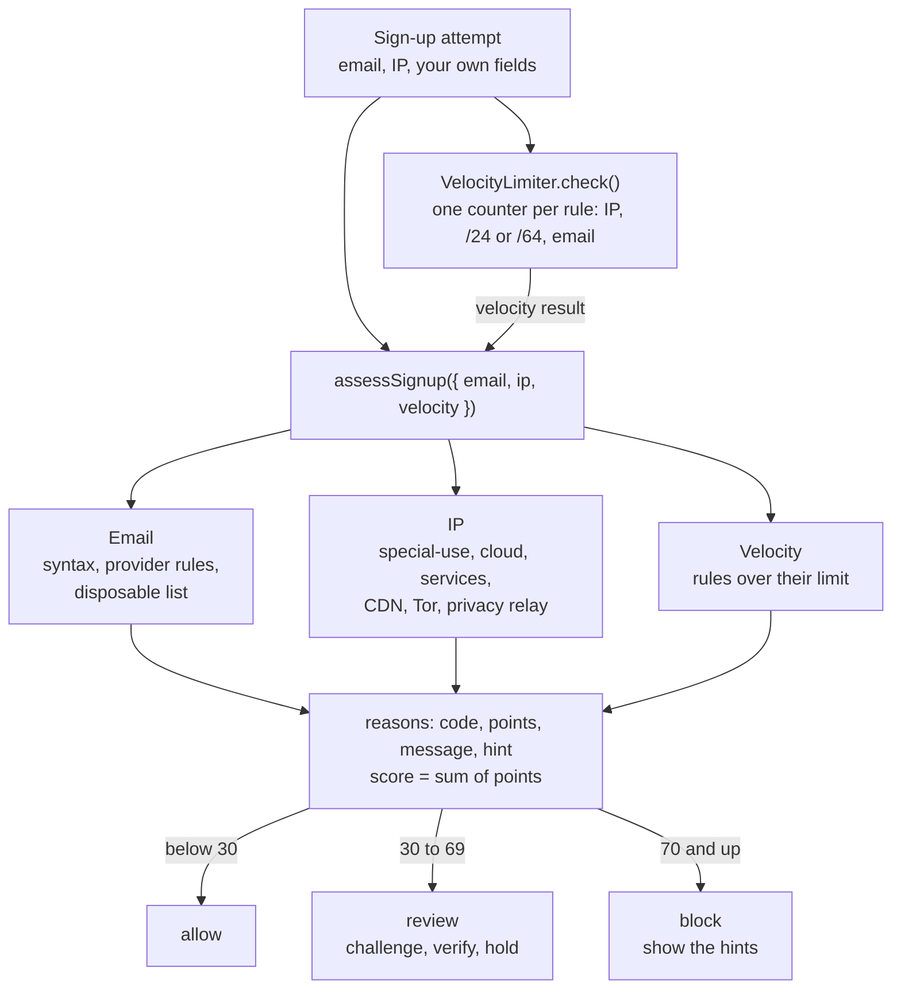

# signup-guard

**Explainable sign-up risk checks for any product: normalized emails, disposable domains, datacenter and Tor addresses, velocity limits, and a score where every point has a written reason.**

[](https://github.com/moonetix/signup-guard/actions/workflows/ci.yml)
[](https://github.com/moonetix/signup-guard/actions/workflows/update-data.yml)
[](LICENSE)
[](package.json)
[](#quick-start)
[](#quick-start)
[](https://packagist.org/packages/moonetix/signup-guard)
[](https://moonetix.com/academy/traffic-quality/stop-fake-signups-rewards-site)

Maintained by [Moonetix](https://moonetix.com).

Fake accounts are cheap to make, and the cheap ones look alike: a throwaway inbox, a rented server, ten attempts in a minute. signup-guard checks for exactly those traits with public data you can read yourself, and returns a decision together with the reasons behind it. A support agent can read the reasons, a user can be told what to fix, and nothing is decided by a model you cannot inspect.

- **JavaScript:** ESM, Node 20+, zero dependencies, TypeScript declarations.
- **PHP:** 8.1+, zero dependencies, standard extensions only.
- **One spec:** both suites run the same [test vectors](test-vectors/vectors.json), so the two ports give the same answer to the same input.
- **Data you can audit:** the [disposable-email-domains](https://github.com/disposable-email-domains/disposable-email-domains) list (CC0) and [moonetix/datacenter-ip-ranges](https://github.com/moonetix/datacenter-ip-ranges), vendored in [`data/`](data/SOURCES.md) and refreshed every week.

## The checks



| Function | What it does |
| --- | --- |
| `assessSignup(input, options)` | Runs every check and returns `score`, `decision`, `reasons` and the raw results |
| `normalizeEmail(email, options)` | Validates an address and returns the form to check duplicates against |
| `checkDisposable(emailOrDomain, options)` | Disposable list lookup on the domain and every parent domain, with allow and block lists |
| `lookupIp(ip, options)` | Public or special-use, plus every listed range that contains the address |
| `normalizeIp(ip)`, `ipNetwork(ip)` | Canonical address text, and the /24 or /64 it belongs to |
| `new VelocityLimiter({ store, rules })` | Fixed-window attempt counters per IP, network, normalized email or your own field |
| `MemoryStore` | In-process counters for tests and single-process apps |
| `createData`, `loadData`, `dataInfo` | Use your own lists, load a snapshot folder, read snapshot dates and counts |
| `PROVIDERS`, `DEFAULT_WEIGHTS`, `DEFAULT_THRESHOLDS`, `DEFAULT_VELOCITY_RULES` | The defaults, as data |
| `parseIp`, `formatIp`, `parseCidr`, `specialRange`, `SPECIAL_RANGES`, `IP_CATEGORIES`, `EMAIL_PROBLEMS` | Lower-level IP parsing, the special-use table, and the `problem` codes `normalizeEmail` can return (`empty`, `non-ascii`, `missing-at`, `multiple-at`, `too-long`, `local-too-long`, `local-invalid`, `domain-literal`, `domain-invalid`) |
| `SignupGuardError` | Thrown for bad arguments, options, rules or data. `code` is one of `invalid_argument`, `invalid_option`, `invalid_rule`, `data_error` |

In PHP the same functions are static methods of `Moonetix\SignupGuard\SignupGuard`, and the limiter is `Moonetix\SignupGuard\VelocityLimiter`. Options use the same names in both languages. PHP throws `SignupGuardException` (an `InvalidArgumentException`) with the same codes in `$e->errorCode`, and adds `exportData`, `loadExported` and `cachedData` for PHP-FPM. The defaults are `SignupGuard::DEFAULT_WEIGHTS`, `SignupGuard::DEFAULT_THRESHOLDS` and `VelocityLimiter::DEFAULT_RULES`; the lower-level helpers live in `Ip` (`parse`, `format`, `parseCidr`, `special`, `SPECIAL`) and `Email` (`PROVIDERS`, `PROBLEMS`).

## Install

The PHP package is on [Packagist](https://packagist.org/packages/moonetix/signup-guard). The JavaScript package is not on npm yet, so install it from Git:

```bash
composer require moonetix/signup-guard
npm install github:moonetix/signup-guard
```

Without Composer, `require 'php/autoload.php';` from a copy of the repository.

## Quick start

**JavaScript** ([examples/quickstart.mjs](examples/quickstart.mjs))

```js
import { assessSignup, VelocityLimiter } from 'signup-guard';

const limiter = new VelocityLimiter(); // in-memory: fine for one process, see "Velocity stores" otherwise

async function screenSignup({ email, ip }) {
  const now = Math.floor(Date.now() / 1000);
  const velocity = await limiter.check({ now, ip, email }); // count the attempt before you judge it
  return assessSignup({ email, ip, velocity });
}

const result = await screenSignup({ email: 'Jane.Doe+promo@googlemail.com', ip: '3.5.140.2' });

console.log(result.decision, result.score);
for (const r of result.reasons) console.log(`${r.code} +${r.points}: ${r.message}`);
console.log(result.email.normalized);
```

```text
review 40
email_normalized +0: Normalized to janedoe@gmail.com (lowercased, domain alias replaced, plus tag removed, dots removed). Check duplicates against this form.
ip_datacenter +40: 3.5.140.2 is in a datacenter range: Amazon Web Services (cloud, 3.5.128.0/19).
janedoe@gmail.com
```

**PHP** ([examples/quickstart.php](examples/quickstart.php))

```php
require 'vendor/autoload.php';

use Moonetix\SignupGuard\SignupGuard;
use Moonetix\SignupGuard\VelocityLimiter;

$limiter = new VelocityLimiter(); // in-memory: PHP-FPM needs a shared store, see "Velocity stores"

$email = 'Jane.Doe+promo@googlemail.com';
$ip = '3.5.140.2';

$velocity = $limiter->check(['now' => time(), 'ip' => $ip, 'email' => $email]);
$result = SignupGuard::assessSignup(['email' => $email, 'ip' => $ip, 'velocity' => $velocity]);

echo $result['decision'], ' ', $result['score'], "\n";
foreach ($result['reasons'] as $r) {
    echo "{$r['code']} +{$r['points']}: {$r['message']}\n";
}
echo $result['email']['normalized'], "\n";
```

The output is the same as above. Store `email.normalized` in a column with a unique index and keep sending mail to the address the user typed.

### Acting on the decision

Each reason carries a `hint` that is safe to show the person signing up. It never names a limit or a list, so an attacker learns nothing they can tune against.

```js
import { assessSignup } from 'signup-guard';

const result = assessSignup({ email: 'temp123@mailinator.com', ip: '81.2.69.142' });

if (result.decision === 'allow') {
  console.log('create the account');
} else if (result.decision === 'review') {
  console.log('create it, but require a challenge and a verified email before it can do anything valuable');
} else {
  const hints = [...new Set(result.reasons.map((r) => r.hint).filter(Boolean))];
  console.log('ask the user to fix:', hints);
}
console.log(result.reasons.map((r) => r.code));
// ask the user to fix: [ 'Please use a permanent email address.' ]
// [ 'email_disposable' ]
```

| Decision | Suggested action |
| --- | --- |
| `allow` | Create the account. Still verify the email before anything of value. |
| `review` | Prefer soft steps: a bot challenge such as Turnstile, email verification, a hold on rewards or credits until the account has aged, a manual look before the first payout. |
| `block` | Refuse with the hints. Log the reasons, and give people a way to reach a human. |

### Building blocks

([examples/building-blocks.mjs](examples/building-blocks.mjs), [examples/building-blocks.php](examples/building-blocks.php))

```js
import { normalizeEmail, checkDisposable, lookupIp, ipNetwork } from 'signup-guard';

normalizeEmail('J.Smith+news@GoogleMail.com').normalized;            // 'jsmith@gmail.com'
normalizeEmail('shop@carol.fastmail.com').normalized;                // 'carol@fastmail.com'
normalizeEmail('erin+tag@outlook.com').normalized;                   // 'erin+tag@outlook.com'
normalizeEmail('erin+tag@outlook.com', { plusTagDomains: ['outlook.com'] }).normalized; // 'erin@outlook.com'
normalizeEmail('kim@@example.org').problem;                          // 'multiple-at'

checkDisposable('x@inbox.mailinator.com');
// { domain: 'inbox.mailinator.com', disposable: true, matchedDomain: 'mailinator.com', source: 'list', allowedBy: null }

const ip = lookupIp('::ffff:3.219.87.128');
[ip.ip, ip.categories, ip.matches.map((m) => m.provider)];          // [ '3.219.87.128', [ 'cloud', 'services' ], [ 'github', 'aws' ] ]
lookupIp('100.64.12.7').special;                                     // { cidr: '100.64.0.0/10', kind: 'cgnat', description: 'a carrier-grade NAT address' }
ipNetwork('2001:db8:abcd:12:ff::1');                                 // '2001:db8:abcd:12::/64'
```

```php
use Moonetix\SignupGuard\SignupGuard as Guard;

Guard::normalizeEmail('J.Smith+news@GoogleMail.com')['normalized'];  // 'jsmith@gmail.com'
Guard::checkDisposable('x@inbox.mailinator.com')['matchedDomain'];  // 'mailinator.com'
Guard::lookupIp('::ffff:3.219.87.128')['categories'];               // ['cloud', 'services']
Guard::ipNetwork('2001:db8:abcd:12:ff::1');                         // '2001:db8:abcd:12::/64'
```

## Configuration

### Reasons and default weights

The score is the sum of the points of the reasons. Nothing else goes into it. A reason with 0 points still appears, as information for your logs.

| Code | Points | Added when | Hint shown to the user |
| --- | ---: | --- | --- |
| `email_invalid` | 100 | The address fails the syntax check (one `@`, dot-atom local part up to 64 characters, host name with at least two labels, ASCII) | Check the email address for typos. |
| `email_disposable` | 70 | The domain or a parent domain is on the disposable list or your `blockDomains` | Please use a permanent email address. |
| `email_normalized` | 0 | Normalization removed a tag or dots or replaced a domain alias | none |
| `ip_datacenter` | 40 | The address is in a `cloud` or `services` range | Turn off your VPN or proxy, or switch to your home or mobile connection, and try again. |
| `ip_tor` | 40 | The address is a Tor exit | Please sign up without Tor. |
| `ip_cdn` | 15 | The address is in a CDN edge range | If you use a VPN or a privacy service, turn it off and try again. |
| `ip_privacy_relay` | 0 | The address is an iCloud Private Relay egress | none |
| `ip_not_public` | 0 | Private, CGNAT, loopback, link-local, documentation or other special-use address | none |
| `ip_invalid` | 0 | The IP string does not parse | none |
| `velocity_ip` | 30 | An `ip` rule is over its limit | Too many attempts. Please try again later. |
| `velocity_network` | 30 | A `network` rule (/24 or /64) is over its limit | same |
| `velocity_email` | 40 | An `email` rule is over its limit | same |
| `velocity_<key>` | 30 | A rule on your own field is over its limit (`velocity_other` sets the default) | same |

Several tripped rules on the same key add one reason, not one per rule. An address that is both a Tor exit and inside a cloud range gets both reasons.

### `assessSignup` options

| Option | Default | Meaning |
| --- | --- | --- |
| `weights` | `DEFAULT_WEIGHTS` | Points per code, integers from 0 to 1000. Merged over the defaults. `velocity_<yourkey>` and `velocity_other` are accepted. |
| `thresholds` | `{ review: 30, block: 70 }` | `score >= block` is `block`, `score >= review` is `review`. Integers, `1 <= review <= block`. |
| `allowDomains` | `[]` | Domains never treated as disposable, with their subdomains. Wins over both lists. |
| `blockDomains` | `[]` | Extra disposable domains, with their subdomains. |
| `plusTagDomains` | `[]` | Extra domains where `+tag` is removed during normalization. |
| `lowercaseLocal` | `true` | Lowercase the part before `@` for every domain. |
| `data` | bundled snapshot | A data set from `createData()`, `loadData()` or, in PHP, `cachedData()`. |

Input: `{ email, ip, velocity }`, all optional. `velocity` is the result of `VelocityLimiter.check()`. The result also contains `email` (the `normalizeEmail` result), `disposable` and `ip` (the `lookupIp` result), so you can log one object per attempt.

### Velocity rules

| Rule | Key | Limit | Window |
| --- | --- | ---: | --- |
| `ip-hour` | `ip` | 5 | 1 hour |
| `ip-day` | `ip` | 20 | 24 hours |
| `network-day` | `network` | 50 | 24 hours |
| `email-day` | `email` | 5 | 24 hours |

`new VelocityLimiter({ store, rules, keyPrefix })`: `store` defaults to a `MemoryStore`, `rules` to the table above, `keyPrefix` to `"sg:"`. A rule is `{ name, key, limit, windowSeconds }`. `key` is `ip`, `network` (IPv4 /24, IPv6 /64), `email` (the normalized address), or the name of any field you pass to `check()`, such as an app install ID or a phone number. Rules whose value is missing or invalid are skipped, not counted.

`check({ now, ip, email, ...yourFields })` records one attempt for every rule and returns `{ limited, exceeded, results }`, where each result has `rule`, `key`, `value`, `count`, `limit`, `windowSeconds`, `resetAt` and `exceeded`. Call it on every attempt, including the ones that fail validation later, and before you decide.

### Email normalization by provider

A rule is applied only where the provider documents it. Checked on 2026-11-11.

| Provider | Domains | `+tag` removed | Dots removed | Other | Source |
| --- | --- | --- | --- | --- | --- |
| Gmail | gmail.com, googlemail.com | yes | yes | googlemail.com becomes gmail.com | [dots](https://support.google.com/mail/answer/7436150), [+aliases](https://support.google.com/mail/answer/12096), [googlemail](https://support.google.com/mail/answer/10313) |
| Proton Mail | proton.me, protonmail.com, protonmail.ch, pm.me | yes | no | Domains are not merged | [Proton](https://proton.me/support/addresses-and-aliases) |
| Fastmail | fastmail.com, fastmail.fm | yes | no | `tag@user.fastmail.com` becomes `user@fastmail.com` | [Fastmail](https://www.fastmail.help/hc/en-us/articles/360060591053) |
| Yandex Mail | yandex.com, yandex.ru | yes | no | | [yandex.com](https://yandex.com/support/mail/reg.html), [yandex.ru](https://yandex.ru/support/mail/reg.html) |
| Outlook.com | outlook.com, hotmail.com, live.com, msn.com | no | no | Microsoft documents plus addressing for Exchange Online organizations, not for consumer accounts. Opt in with `plusTagDomains`. | [Microsoft Learn](https://learn.microsoft.com/en-us/exchange/recipients-in-exchange-online/plus-addressing-in-exchange-online) |
| iCloud Mail | icloud.com, me.com, mac.com | no | no | Apple documents neither plus addressing nor that `name@me.com` and `name@icloud.com` are always one account | [Apple](https://support.apple.com/en-us/118230) |
| Yahoo Mail | yahoo.com, ymail.com, rocketmail.com | no | no | Disposable addresses are `basename-keyword`, and the base name is chosen apart from the account name, so cutting the keyword does not recover the account | [Yahoo](https://help.yahoo.com/kb/SLN28815.html) |

Zoho Mail, GMX, AOL and Tuta are not in the table: we found no provider documentation either way, so their addresses are only lowercased. Google Workspace and every other custom domain get no provider rules; for Workspace, Google states that dots do change the address. The table is exported as `PROVIDERS`, and a test fails if the two ports drift apart.

## The data

| Folder | Source | License | Used for |
| --- | --- | --- | --- |
| [`data/disposable/`](data/disposable) | [disposable-email-domains](https://github.com/disposable-email-domains/disposable-email-domains), `disposable_email_blocklist.conf` | CC0 1.0 ([copy](data/disposable/LICENSE.txt)) | `checkDisposable`, `email_disposable` |
| [`data/ip/`](data/ip) | [moonetix/datacenter-ip-ranges](https://github.com/moonetix/datacenter-ip-ranges), `data/providers/*.txt` | MIT repository; each feed's terms in [`providers.json`](data/ip/providers.json) | `lookupIp`, the `ip_*` reasons |

[`data/SOURCES.md`](data/SOURCES.md) and [`data/manifest.json`](data/manifest.json) record the upstream commit, the update time and the counts. `dataInfo()` returns the same at runtime.

| IP category | Providers | Reason |
| --- | --- | --- |
| `cloud` | AWS, Google Cloud, Oracle Cloud, DigitalOcean, Akamai Cloud (Linode), Vultr | `ip_datacenter` |
| `services` | Google services, GitHub (including Actions runners) | `ip_datacenter` |
| `cdn` | Cloudflare, Fastly | `ip_cdn` |
| `tor` | Tor exit nodes | `ip_tor` |
| `privacy-relay` | iCloud Private Relay egress | `ip_privacy_relay` |

**Weekly update.** [`update-data.yml`](.github/workflows/update-data.yml) runs every Monday and on demand (`workflow_dispatch`). It runs [`scripts/update-data.mjs`](scripts/update-data.mjs), which pins each upstream to its current commit, downloads the files from that commit, parses every line with the library itself, and compares the result with the snapshot. It refuses to write anything when a download fails, a line does not parse, a provider disappears or a list shrinks by more than half. Then both test suites run, and the workflow commits only when `data/` changed. Run it yourself with `npm run update-data`.

**Your own lists.** `createData({ disposableDomains, ipRanges })` builds a data set from arrays (`ipRanges` entries are `{ cidr, provider, providerName, category }`), and `loadData(dir)` reads a folder with the same layout as `data/`. Pass the result as `data`.

## Velocity stores

`MemoryStore` lives in one process. With several Node processes, or with PHP-FPM, use a shared store. A store has one method, `hit(key, ttlSeconds, now)`, that increments a counter, sets its expiry when it is created, and returns the new count. Keys already contain the window start, so the store needs no clock of its own. Both stores below write the same keys, so a Node service and a PHP app can share counters.

**Redis, Node.js** with the official `redis` client ([examples/redis-store.mjs](examples/redis-store.mjs)):

```js
import { createClient } from 'redis';
import { VelocityLimiter } from 'signup-guard';

// INCR and EXPIRE in one script, so a counter can never be left without an expiry.
const HIT = `local c = redis.call('INCR', KEYS[1])
if c == 1 then redis.call('EXPIRE', KEYS[1], ARGV[1]) end
return c`;

const redis = await createClient({ url: process.env.REDIS_URL ?? 'redis://127.0.0.1:6379' }).connect();

const limiter = new VelocityLimiter({
  store: { hit: (key, ttlSeconds) => redis.eval(HIT, { keys: [key], arguments: [String(ttlSeconds)] }) },
});
```

**Redis, PHP** with phpredis ([examples/redis-store.php](examples/redis-store.php)):

```php
use Moonetix\SignupGuard\VelocityLimiter;
use Moonetix\SignupGuard\VelocityStore;

final class RedisVelocityStore implements VelocityStore
{
    // INCR and EXPIRE in one script, so a counter can never be left without an expiry.
    private const HIT = "local c = redis.call('INCR', KEYS[1])\nif c == 1 then redis.call('EXPIRE', KEYS[1], ARGV[1]) end\nreturn c";

    public function __construct(private Redis $redis)
    {
    }

    public function hit(string $key, int $ttlSeconds, int $now): int
    {
        return (int)$this->redis->eval(self::HIT, [$key, $ttlSeconds], 1);
    }
}

$redis = new Redis();
$redis->connect(getenv('REDIS_HOST') ?: '127.0.0.1', (int)(getenv('REDIS_PORT') ?: 6379));
$limiter = new VelocityLimiter(store: new RedisVelocityStore($redis));
```

A SQL table works too: a primary key on `key`, an upsert that increments `count`, and a periodic delete of expired rows.

## PHP-FPM: load the data once

Parsing the snapshot takes about 190 ms and 32 MB in PHP. That is fine for a CLI job and wasteful on every web request. `cachedData()` writes the parsed tables as a PHP file that holds only literals, which OPcache keeps in shared memory, and rebuilds it when the snapshot changes ([examples/fpm-cache.php](examples/fpm-cache.php)):

```php
use Moonetix\SignupGuard\SignupGuard;

// First call builds a literal-only PHP file; after that OPcache serves it from shared memory.
$data = SignupGuard::cachedData(sys_get_temp_dir() . '/signup-guard-data.php');

$result = SignupGuard::assessSignup(['email' => 'temp123@mailinator.com', 'ip' => '81.2.69.142'], ['data' => $data]);
echo $result['decision'], ' ', $result['score'], "\n"; // block 70
```

With OPcache enabled, a full `assessSignup` including the data load measured about 0.4 ms per request on PHP 8.4. Point the cache file at a directory the PHP user can write and nobody else can. In Node.js the data loads once per process (about 200 ms) and lookups take a few microseconds.

## How it works

1. `VelocityLimiter.check()` derives the values for each rule (canonical IP, /24 or /64, normalized email, your fields) and increments one counter per rule in the current fixed window. The window start is part of the key, so counters expire on their own.
2. `normalizeEmail` trims ASCII whitespace, rejects anything that is not a plain ASCII address, lowercases, then applies the documented provider rules: subdomain tags, domain aliases, `+tags`, dots.
3. `checkDisposable` takes the domain and tests it and each parent domain (never the bare TLD) against your allow list, your block list, then the snapshot.
4. `lookupIp` parses IPv4 and IPv6 strictly (no octal-looking parts, no zone IDs), turns IPv4-mapped IPv6 into IPv4, and checks the special-use ranges first. A private or CGNAT address is reported as not public and never matched against provider ranges.
5. Public addresses go through a binary search over ranges sorted by start, followed by a short walk back for ranges that nest across providers, such as a GitHub block inside an AWS block. Every containing range is returned, most specific first.
6. `assessSignup` turns each finding into a reason with a code, points, a message for you and a hint for the user. The score is the sum of the points, compared with two thresholds.
7. Both ports keep addresses as exact integers or fixed-width bytes, so there is no floating point anywhere, and the shared vectors pin every message string.

## False positives and other pitfalls

Every signal here also fires for honest people sometimes. The defaults are set so that no network signal blocks on its own; a block needs either a bad email or several signals together.

- **Read the right client IP.** Behind a load balancer or CDN, the socket address is the proxy. Take the client address from the header your own proxy sets (for example `CF-Connecting-IP` behind Cloudflare), and never trust `X-Forwarded-For` from the open internet. If many users show up with `ip_not_public`, this is why.
- **Carrier-grade NAT and mobile networks.** Mobile carriers put thousands of subscribers behind a few public IPv4 addresses. Keep per-IP limits generous and count attempts, not accounts.
- **Universities, offices, hotels.** One /24 can be a whole campus. The default `network-day` limit is 50 for that reason; raise it if your audience is students.
- **IPv6.** One home usually gets a whole /64, and rotating within it is free. Per-IP limits on IPv6 are weak, which is why the `network` key groups by /64.
- **iCloud Private Relay.** Safari users on iCloud+ browse through Apple's relay addresses. They are real people, so the reason carries 0 points by default. Private Relay is one of the most common causes of a false VPN warning; see [VPN or proxy detected](https://moonetix.com/academy/traffic-quality/vpn-proxy-detected-offerwall).
- **CDN ranges.** People rarely browse from Cloudflare or Fastly edge addresses, so a hit usually means a proxy or worker in front of the browser. Cloudflare WARP users are not matched: WARP exits from addresses outside Cloudflare's published ranges. The default weight is low (15); check your own logs before raising it.
- **Corporate and school networks.** Company VPN gateways and secure web proxies often run in cloud regions, and Google's service ranges cover some Google-operated proxies and fetchers. A datacenter match alone lands in `review`, not `block`, for that reason.
- **Residential proxies are invisible here.** They route through home connections and are in no provider list. Range checks stop the cheapest automation; slow attacks spread over residential addresses need behavior signals and checks at payout. See [What is a residential proxy?](https://moonetix.com/academy/glossary/what-is-a-residential-proxy).
- **The disposable list is not perfect.** The maintainers say they cannot guarantee every entry is still disposable. Keep `allowDomains` for the ones your users prove wrong, and `blockDomains` for new ones you find.
- **Normalize for duplicates, not for mail.** Send to the address the user typed. Gmail rules apply only to gmail.com and googlemail.com; a Workspace domain on Google's servers keeps its dots.
- **Fixed windows allow bursts at the edge.** A client can use a full limit at 00:59 and another at 01:00. Pair a short window with a longer one, as the defaults do.
- **Tell people what to fix.** Show the `hint`, not the score or the rule. Keep an appeal path to a person, and look at what appeals overturn: a rule that keeps losing appeals needs a lower weight.
- **Mind what you store.** Velocity keys contain IPs and emails for at most the window length. If that is too much for your privacy policy, pass a keyed hash as a custom field and use it as the rule key instead of `email`.

[What is IP reputation?](https://moonetix.com/academy/glossary/what-is-ip-reputation) covers shared addresses and fair handling in more depth.

## What signup-guard does not do

- **No device fingerprinting.** It reads an email address and an IP address, and anything else only if you pass it as a velocity field.
- **No network calls at runtime.** Every check is local. Downloads happen only in the update script, on your schedule.
- **No MX or SMTP checks.** They are slow, they fail during DNS outages, and a working inbox proves little. Send a verification email instead.
- **No bot challenge.** Use Turnstile, hCaptcha or reCAPTCHA, verified on your server, for the `review` band.
- **No machine learning.** Weights are integers in a table you can read and change.

## Common errors

| You see | Cause and fix |
| --- | --- |
| `velocity must be the result of VelocityLimiter.check()` | In Node, `check()` is async and you passed the Promise. `await` it first. |
| `now must be a non-negative integer (Unix seconds)` | `now` is missing or not an integer. Use `Math.floor(Date.now() / 1000)` or `time()`. |
| Velocity limits never trip, and no error | `now` is in milliseconds (`Date.now()`). It passes the integer check, but every window becomes 1,000 times shorter, so a one-hour rule resets every 3.6 seconds. Divide by 1000. |
| `Unknown reason code "..."` | `weights` accepts only the codes in the table above, plus `velocity_<yourkey>` and `velocity_other`. |
| `thresholds must be integers with 1 <= review <= block` | A threshold is not an integer, `review` is below 1, or `review` ends up above `block`. A single key is merged over the defaults, so `{ review: 80 }` alone fails against the default `block: 70`. |
| `store.hit must return the new count as a positive integer` | Your store returned a string, nothing, or 0. Cast the Redis reply to an integer, as the PHP store above does. |
| `Cannot write /path/to/cache.php` (PHP) | `cachedData()` could not write next to the cache file. Use a directory the PHP-FPM user owns. |
| `Cannot read <dir>/ip/providers.json` (PHP), `ENOENT ... ip/providers.json` (Node) | `loadData(dir)` points at a folder without the `data/` layout. Copy the whole `data/` folder, not only the lists. |

Errors thrown by the library are `SignupGuardError` in Node and `SignupGuardException` in PHP, with the same `code` in both. Bad input from users never throws: an unparsable email or IP becomes an `email_invalid` or `ip_invalid` reason.

## Tests

```bash
npm test                  # node --test: shared vectors, API tests, checks on the bundled snapshot
php php/tests/run.php     # shared vectors, PHP-specific checks, the same snapshot checks
```

`test-vectors/vectors.json` holds 204 cases: email syntax and provider rules, IPv4 and IPv6 parsing and RFC 5952 formatting, CIDR edges, nested ranges, special-use ranges, disposable matching with allow and block lists, velocity windows and their boundaries, and full assessments with every message string. They run against a small fixture data set inside the file, never the snapshot, so a weekly data update cannot break them. CI runs both suites on Node 20 and 22 and PHP 8.1 and 8.4, runs every example, and runs the Redis examples against a Redis service.

## Further reading

- Moonetix Academy: [How to stop fake signups](https://moonetix.com/academy/traffic-quality/stop-fake-signups-rewards-site), [Stop multi-accounting and VPN abuse](https://moonetix.com/academy/traffic-quality/stop-multi-accounting-vpn-abuse), [What is IP reputation?](https://moonetix.com/academy/glossary/what-is-ip-reputation), [What is a residential proxy?](https://moonetix.com/academy/glossary/what-is-a-residential-proxy), [VPN or proxy detected](https://moonetix.com/academy/traffic-quality/vpn-proxy-detected-offerwall), [How to prevent referral fraud](https://moonetix.com/academy/traffic-quality/prevent-referral-fraud)
- Data: [moonetix/datacenter-ip-ranges](https://github.com/moonetix/datacenter-ip-ranges), [disposable-email-domains](https://github.com/disposable-email-domains/disposable-email-domains)

## About Moonetix

Moonetix is an affiliate network. Publishers add its offerwall to an app, game, website, bot or community, and users earn the publisher's own currency by completing offers. Publisher accounts: [moonetix.com/register](https://moonetix.com/register?from=github-signup-guard).

Other open source from Moonetix: [reward-economy-kit](https://github.com/moonetix/reward-economy-kit), [country-tiers](https://github.com/moonetix/country-tiers), [datacenter-ip-ranges](https://github.com/moonetix/datacenter-ip-ranges), [offerwall-fraud-playbook](https://github.com/moonetix/offerwall-fraud-playbook), [referral-engine](https://github.com/moonetix/referral-engine), [gamification-kit](https://github.com/moonetix/gamification-kit), [awesome-offerwalls](https://github.com/moonetix/awesome-offerwalls), [offerwall-postback-handlers](https://github.com/moonetix/offerwall-postback-handlers).

## License

MIT. See [LICENSE](LICENSE). The vendored data keeps its own terms, listed in [data/SOURCES.md](data/SOURCES.md).
